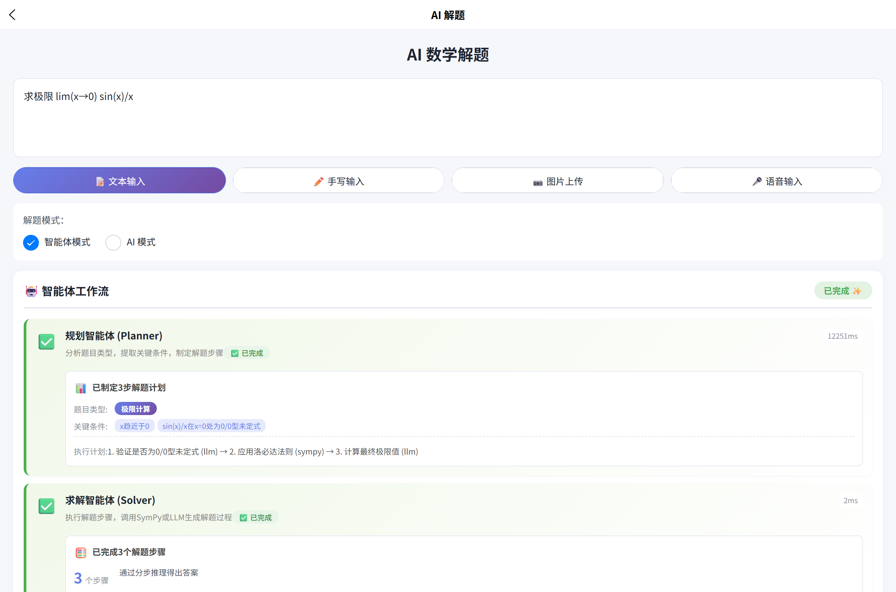
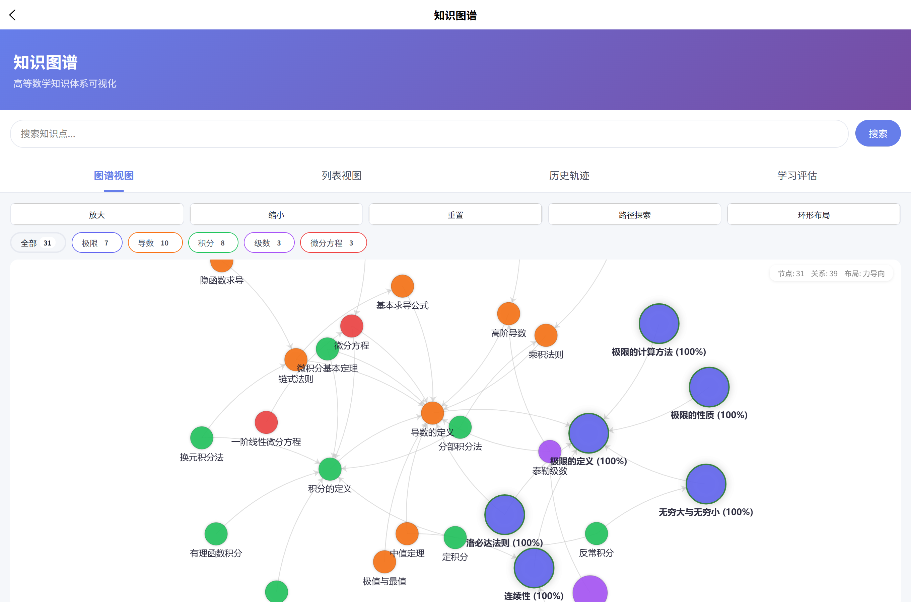
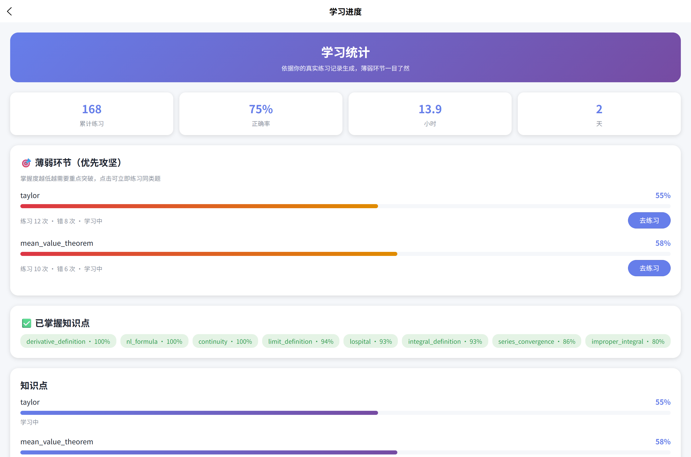
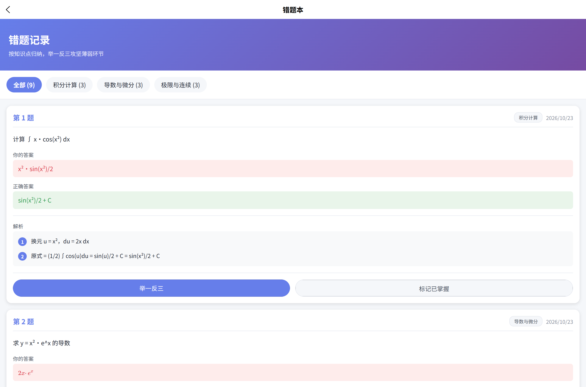
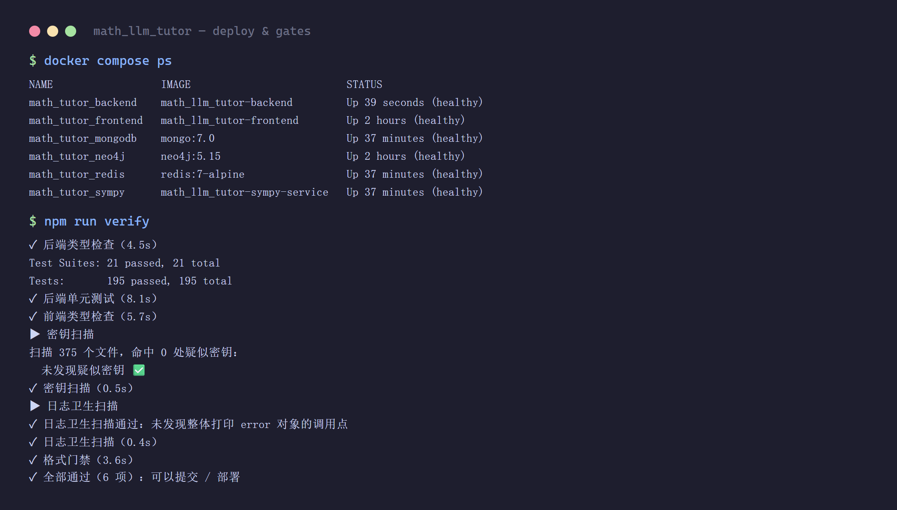
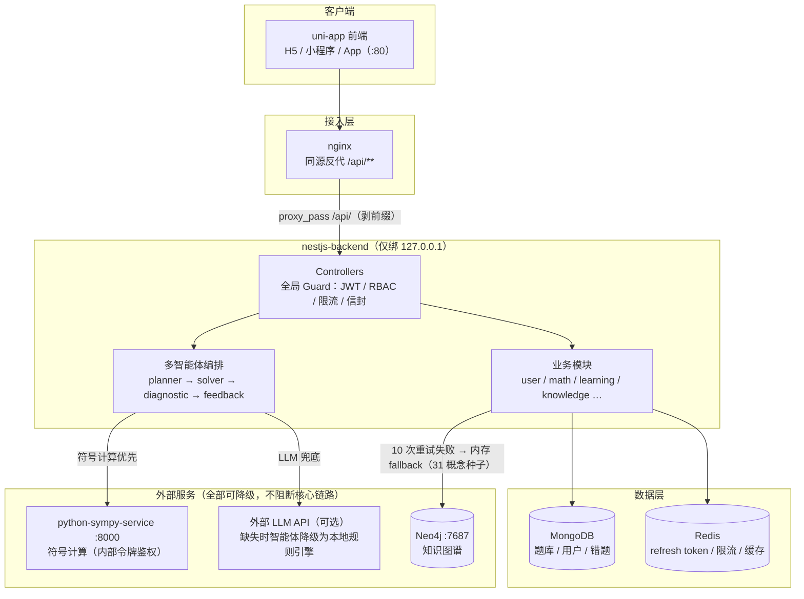

# 高等数学智能教育系统 · Math LLM Tutor


> 基于 **NestJS + MongoDB + Neo4j + Vue3/UniApp** 的高等数学 AI 辅导系统。
> 核心链路：题目 → 多智能体（planner / solver / diagnostic / feedback）→ SymPy 符号计算 → 分步解答 + 掌握度诊断。

| AI 解题（多智能体工作流） | 知识图谱（ECharts 力导向） |
|---|---|
|  |  |

| 学习进度（掌握度 / 薄弱环节） | 错题本（按知识点归纳） |
|---|---|
|  |  |

| 部署与健康门禁 |
|---|
|  |

当前状态：**可部署工程原型**。已建立完整的上线门禁（`npm run verify`）、部署加固探针（`npm run verify:probe`）、认证授权探针（`npm run auth:probe`）与 CI（`.github/workflows/verify.yml`），评估依据见 [`docs/可部署性评估报告.md`](./docs/可部署性评估报告.md)。

---

## 一、技术栈

| 层 | 技术 | 说明 |
|---|---|---|
| 后端 API | NestJS 11 + TypeScript 5 | 分层架构（Controller / Service / Guard / Module），全局 Guard 强制 RBAC |
| 数据库 | MongoDB 7（题库 / 用户 / 错题）、Redis 7（refresh token / 限流 / 缓存）、Neo4j 5（知识图谱） | Redis 缺失时降级为进程内内存（仅单实例可用） |
| 符号计算 | Python FastAPI + SymPy（`python-sympy-service`） | 内部令牌鉴权、表达式白名单、子进程超时 |
| 公式渲染 | 独立渲染服务（`formula-renderer-service`） | LaTeX → 图片 |
| 前端 | uni-app + Vue 3 + Vite（`uniapp-frontend`） | 多端（H5 / 小程序 / App），KaTeX + ECharts |
| 编排 | docker-compose | 后端端口仅绑 `127.0.0.1`，前端经 nginx 同源反代 `/api/**` |

---

## 二、目录结构

```
math_llm_tutor/
├── nestjs-backend/          # 后端 API（NestJS）
│   ├── src/
│   │   ├── common/          # 过滤器 / 守卫 / 拦截器 / 中间件 / 工具
│   │   ├── core/auth/       # 认证：JWT、refresh 轮换、登录锁定、RBAC
│   │   └── modules/         # 业务模块（user / math / agents / learning …）
│   ├── test/
│   ├── Dockerfile
│   └── .env.example         # 后端环境变量样例
├── uniapp-frontend/         # 前端（uni-app + Vue3）
│   ├── src/
│   ├── docker/nginx/        # nginx 同源反代配置
│   └── package.json
├── python-sympy-service/    # SymPy 符号计算服务
├── formula-renderer-service/# 公式渲染服务
├── datasets/                # 题库 / 基准数据
├── docs/                    # 设计 / 评估 / 自检 / 部署文档
├── scripts/                 # 验证与部署脚本（verify-all / deploy-probe / secret-scan / self-check …）
├── docker-compose.yml       # 一键编排
├── .env.example             # 根级环境变量样例（生产部署用）
├── .github/workflows/verify.yml  # CI
└── package.json             # 根级编排脚本
```

---

## 三、系统架构



设计要点：

- **符号计算优先、LLM 兜底**：solver 先走 SymPy 符号求解，失败/不可用时才降级到 LLM 或本地规则引擎（`solver.agent.ts`），保证无 API key 时核心解题链路仍可用。
- **多智能体编排**：`AgentOrchestrator` 按 planner → solver → diagnostic → feedback 顺序执行，diagnostic 用参考解对 solver 产出做规则/AI 双重校验。
- **所有外部依赖可降级**：SymPy 不可达 → 规则引擎；LLM key 缺失 → 规则模板；Neo4j 不可达 → 内存知识图谱；Redis 缺失 → 进程内缓存（仅单实例）。
- **安全默认**：后端只绑 `127.0.0.1`，浏览器只触达 nginx；`TRUST_PROXY` 默认关闭（不信任 `X-Forwarded-For`）。

---

## 四、快速开始

### 前置条件

- Docker 24+ 与 Docker Compose v2
- （本机开发）Node 20+、Python 3.11+、MongoDB 7（或用 compose 起依赖）

### 方式一：Docker 一键部署（推荐）

```bash
# 1. 复制环境变量样例并填入真实值
cp .env.example .env               # 根级（compose 用）
cp nestjs-backend/.env.example nestjs-backend/.env   # 后端进程用

# 2.【必填】把 .env 里的 JWT_SECRET 改成 ≥32 字符的强随机值。
#    照抄 .env.example（JWT_SECRET 留空）会回落到 compose 的弱密钥默认值，
#    后端以生产模式启动时直接拒绝启动，陷入 crash loop（restart: unless-stopped）。

# 3. 启动全部服务
docker compose up -d

# 4. 确认健康
docker compose ps                  # 全部 healthy
curl http://localhost/health/ready # 200 = 就绪
```

前端访问 `http://localhost`，后端 API 经 nginx 同源反代 `http://localhost/api/**`。

### 方式二：本机开发

```bash
# 后端
cd nestjs-backend
npm install
npm run start:dev                  # http://localhost:3000

# 前端
cd uniapp-frontend
npm install
npm run dev:h5                     # http://localhost:5173

# SymPy 服务
cd python-sympy-service
pip install -r requirements.txt
python main.py                     # http://localhost:8000
```

---

## 五、环境变量

完整清单见 [`.env.example`](./.env.example)（根级，compose 用）与 [`nestjs-backend/.env.example`](./nestjs-backend/.env.example)（后端进程用）。**只提交 `.env.example`，真实 `.env` 已在 `.gitignore` 中，不要提交真实密钥。**

关键项：

| 变量 | 必填 | 说明 |
|---|---|---|
| `JWT_SECRET` | ✅ 必填 | ≥32 字符且非默认值；生产环境使用弱密钥/默认值会**直接拒绝启动** |
| `MONGODB_URI` | ✅ | 含库名 |
| `CORS_ORIGIN` | ✅（生产） | 逗号分隔白名单；**生产缺失直接拒绝启动** |
| `JWT_EXPIRATION` | 建议 `15m` | **生产 >1h 拒绝启动** |
| `TRUST_PROXY` | 反代部署必填 | 默认空=不信任 `X-Forwarded-For`；compose 默认 `1` |
| `ENABLE_SWAGGER` | 可选 | 生产默认关闭 API 文档 |
| `SYMPY_INTERNAL_TOKEN` | 建议 | 后端与 sympy-service 必须一致 |
| 各 `AI_*_API_KEY` | 可选 | 缺失时智能体降级为本地规则引擎 |

---

## 六、验证门禁（提交 / 部署前必跑）

```bash
npm run verify          # 6 项全绿才可交付：
                        #   后端 tsc / jest / 前端 vue-tsc / 密钥扫描 / 日志卫生 / prettier 格式
npm run verify:probe    # 部署加固探针 15 项（限流伪造 / 安全头 / CORS 403 / Swagger 收敛 / 探针语义）
npm run auth:probe      # 认证授权探针（RBAC / 轮换 / 锁定 / 信封）
npm run check:sh        # 启动脚本结构校验
node scripts/self-check.cjs --mode local --full   # 集成自检（需 Mongo / SymPy）
```

CI（`.github/workflows/verify.yml`）与本地同一份脚本，避免"本地绿、CI 红"。

---

## 七、基准评测与 A/B 消融（可复现）

### 核心指标

| 指标 | 数值 | 可核对依据 |
|---|---|---|
| 基准集规模 | 500 题（11 个高数领域） | `datasets/benchmark-dataset.json` |
| 符号可解子集 | 54 题 | `results/eval-summary.md` |
| 解出题数 | 21 题 | `results/eval-summary.md`（成功求解 21） |
| **解出即正确** | **21 / 21** | `results/eval-summary.md`（判为正确 21，成功子集正确率 1.0） |
| 判定方式 | 数值等价 + 符号等价（`simplify(a-b)==0`）双重判定 | `scripts/benchmark-eval.cjs` |
| 符号直解延迟 | 35 ms / 题（对照多智能体流水线 4018 ms） | `results/ablation-summary.md` |

> 口径说明：上表"解出即正确"指**成功求解子集内**判定为正确的比例，体现的是判定器的严格性——本系统宁可记为 `unsupported`，也不虚报答案。它**不是**全量 500 题的整体准确率；未接入的题型（证明/选择/含 `+C` 不定积分）显式记为 `unsupported`，不纳入统计。

`datasets/benchmark-dataset.json` 是 500 题标准基准集（`高等数学LLM基准测试集_v2`，覆盖 11 个高数领域）。`scripts/benchmark-eval.cjs` 对其中的**符号可解计算子集**做真实求解评测：

```bash
# 先起 SymPy 服务
cd python-sympy-service && python main.py   # 默认 127.0.0.1:8000

# 评测（默认全量符号可解子集，可 --limit N 抽样 / --domain 某域）
node scripts/benchmark-eval.cjs
# 产物：results/eval-summary.md（摘要）+ results/eval-raw.json（逐题原始数据）
```

评测链路：**题面 LaTeX 解析 → LaTeX→SymPy 转换 → 符号求解（limit/derivative/integral）→ 数值等价 + 符号等价（`simplify(a-b)==0`）双重判定**。逐题原始数据全量落盘，结果可复现。当前评测范围与结论见 [`results/eval-summary.md`](./results/eval-summary.md)。

> 说明：本评测只覆盖"有确定性符号答案"的计算子集，证明题/选择题/含 `+C` 的不定积分需扩展求解器接入；未接入的题显式记为 `unsupported`，不纳入准确率统计，避免虚报。

### A/B 消融：多智能体流水线 vs 纯符号直解

`scripts/ablation-eval.cjs` 在**同一题面子集**上对照两条链路：策略 A 纯符号直解（本评测链路）vs 策略 B 线上 `POST /agents/solve` 多智能体端点（planner→solver→diagnostic→feedback，含编排开销），用同一判定器比对标准答案并记录逐题耗时：

```bash
# 需 SymPy 服务（:8000）与后端（默认 :3100，可用 BACKEND_URL 覆盖）同时可用
node scripts/ablation-eval.cjs
# 产物：results/ablation-summary.md（摘要）+ results/ablation-raw.json（逐题原始数据）

# 注意：后端 /agents/* 端点限流 20 次/5 分钟/IP，脚本默认 16s 间隔 + 429 指数退避
```

### 一次失败实验的价值：瓶颈是如何定位的

本轮 A/B 消融本身是一份"诚实暴露差距"的工程记录，其价值不在于通过率，而在于它把瓶颈**精确定位到了可行动的一层**：

| 指标 | A 纯符号直解 | B 多智能体流水线 |
|---|---|---|
| 评测题数（公平口径） | 27 | 27 |
| 解出即正确 | **21 / 21** | 0 / 27 |
| 平均耗时 | **35 ms** | 4018 ms |

同一台 SymPy 服务，经本评测的 LaTeX→SymPy 转换器（策略 A）21/21 全对；经多智能体端点（策略 B）0/27。结论与归因（详见 [`results/ablation-summary.md`](./results/ablation-summary.md)）：

- **瓶颈在题面解析层，而非符号内核**：B 的 solver 本地计算路径无法消化基准集的 LaTeX 题面，全部跌出到规则引擎兜底；符号计算内核本身（A 已证明）21/21 正确。
- **编排开销可量化**：B 均耗 4018ms ≈ A（35ms）的 115 倍，为四智能体串行编排 + 规则兜底的固定成本。
- **P1 行动项**：把 `scripts/latex-to-sympy.cjs` 的转换能力移植进 solver 本地计算路径（或直接复用），消除 LaTeX 题面解析缺口；同时把"已整理结论"等无信息泛化文本纳入 `isPlaceholderResult` 检测。

> 这种"先跑对照组、再定位瓶颈到具体层"的做法，正是本仓库评测链路的可复现方法论：两策略吃相同题面、用同一判定器、逐题原始数据落盘 `results/ablation-raw.json`。

---

## 八、健康探针

| 端点 | 用途 | 依赖 | 期望 |
|---|---|---|---|
| `/health/live` | **liveness** | 无 | 恒 `200`，毫秒级 |
| `/health/ready` | **readiness** | Mongo、已配置的 Redis | 就绪 `200` / 不就绪 `503` |
| `/health` | 人工排查 | 全量 | `200`（**不要做探针**，最坏 15s+） |

容器 healthcheck 一律打 `/health/live`。SymPy / Neo4j 为可降级依赖，`/health/ready` 刻意不查。

---

## 九、安全基线

- 短时效 access（15m）+ 服务端 refresh（30d，仅存 SHA-256，用一次即轮换 + 重用检测）
- 登录失败锁定（账号维度，共享 IP 不连坐）
- RBAC：`@Roles()` 由全局 `RolesGuard` 强制执行（无元数据即拒绝）
- 统一错误信封 `{code, statusCode, message, traceId}`，生产不回传堆栈
- 日志脱敏（Bearer / sk- / JWT / 敏感字段）
- 限流键取 `request.ip`，**不信任** `X-Forwarded-For`（除非显式开 `TRUST_PROXY`）
- 生产默认不注册 Swagger

详见 [`docs/部署就绪清单.md`](./docs/部署就绪清单.md)。

---

## 十、已知限制

1. **多实例必须配 Redis**：未配置时降级为进程内内存，多实例会不一致。
2. **长任务同步返回**：多智能体求解为串行同步调用（数十秒），尚未任务化 + SSE；生产建议网关超时 ≥60s。
3. **前端生产构建未在本机验证**：由 CI 的 `build:h5` 门禁覆盖。
4. **评测覆盖范围有限**：基准评测目前覆盖极限/导数/积分等符号可解计算子集，证明题/选择题/含 `+C` 不定积分尚未接入求解器，均显式记为 `unsupported`。扩展求解器接入范围是后续迭代方向（详见 [`results/eval-summary.md`](./results/eval-summary.md)）。

---

## 十一、文档索引

**评估与门禁**

- [`docs/可部署性评估报告.md`](./docs/可部署性评估报告.md) — 7 维度评估结论与依据
- [`docs/部署就绪清单.md`](./docs/部署就绪清单.md) — 组件 / 端口 / 环境变量 / 门禁 / 安全基线
- [`docs/deployment-check-report.md`](./docs/deployment-check-report.md) — 功能部署与 KatCoder 故障排查报告
- [`docs/performance-report.md`](./docs/performance-report.md) — 系统性能测试报告

**代码审阅与改进**

- [`docs/系统代码审阅与改进方案.md`](./docs/系统代码审阅与改进方案.md) — 系统性短板与改造方向
- [`docs/目标对照与缺陷清单.md`](./docs/目标对照与缺陷清单.md) — 目标 vs 实现分级缺陷清单
- [`docs/改进实施进度.md`](./docs/改进实施进度.md) — 审阅方案的落地进度
- [`docs/方案复盘与第二轮实施报告.md`](./docs/方案复盘与第二轮实施报告.md) — 第二轮改造复盘
- [`docs/实现自检报告.md`](./docs/实现自检报告.md) — 20 项自检发现（第二轮改造后）
- [`docs/optimization-plan.md`](./docs/optimization-plan.md) — 系统整体优化方案

**设计选型与专题**

- [`docs/Neo4j取舍论证.md`](./docs/Neo4j取舍论证.md) — 知识图谱选型理由、实测现状与取舍建议
- [`docs/sympy-examples.md`](./docs/sympy-examples.md) — SymPy 求解示例集合

**故障排查与修复记录**

- [`docs/troubleshooting-report.md`](./docs/troubleshooting-report.md) — 故障排查报告
- [`docs/system-function-fix-report.md`](./docs/system-function-fix-report.md) — 系统功能修复报告（英文版）
- [`docs/user-feedback-fix-report.md`](./docs/user-feedback-fix-report.md) — 用户反馈问题修复报告
- [`docs/user-requirements-fix-report.md`](./docs/user-requirements-fix-report.md) — 用户需求修复报告

---

## License

ISC（见 `package.json`）。本仓库为工程原型，按"现状"提供。